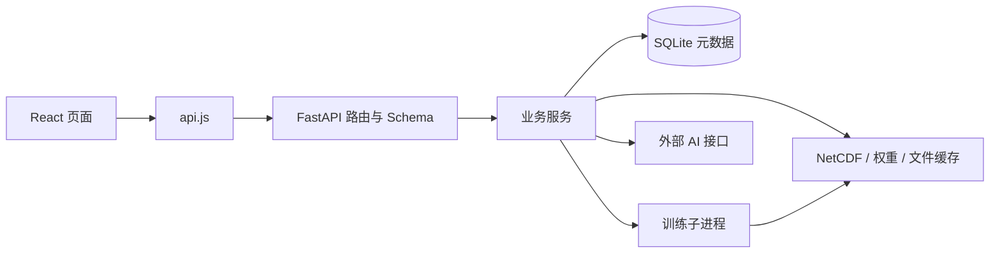

# AstraAtmos 行星大气实验室

<div align="center">
  <picture>
    <source media="(prefers-color-scheme: dark)" srcset="./assets/brand/astraatmos/astraatmos-mark-dark.png" />
    
  </picture>
  <p><strong>Planetary Atmosphere Prediction & Experiment Platform</strong><br />面向多行星大气数据分析、模型训练与时空预测实验的平台</p>
</div>

[项目仓库](https://github.com/ZongAn-W/AstraAtmos) · [自定义模型接入](docs/uploaded-model-training.md) · [Linux 部署](scripts/deploy/README_DEPLOY_CN.md) · [Windows 分发](scripts/release/README_CN.md)

## 项目简介

AstraAtmos（行星大气实验室）定位为行星大气预测实验平台，从火星臭氧研究起步，以 OpenMARS 再分析数据、MCD 气候模拟数据和地球 MERRA-2 三小时数据为当前数据基础，将数据管理、模型训练、预测、模型对比和三维可视化整合到同一个 Web 平台。当前已开放火星臭氧训练与预测，以及地球三小时数据总览、官方 DLinear 和独立契约上传模型的训练与历史回测；日频地球数据集已停用，更多行星和变量预测任务仍属后续扩展。

前端视觉令牌、主题与基础控件的一致性和可访问性约定见[前端说明](frontend/README.md#界面样式与可访问性)；单模型预测的紧凑准备面板、训练运行条与访客登录入口等布局细节见[共用单模型预测工作台](docs/shared-single-model-prediction.md)。

AstraAtmos 使用「大气之 A / Atmospheric A」作为正式标志：冰蓝 A 字母、上扬的弧形大气流线与橙色观测点。全站导航、首页强调色、关于页、页脚与浏览器图标已统一使用该标志，深浅主题分别使用对应配色。品牌组件为 [BrandMark.jsx](frontend/src/components/BrandMark.jsx)，资产规范与文件清单见[标识设计与使用说明](assets/brand/astraatmos/README.md)，接入范围见[品牌接入方案](docs/plans/2026-09-24-atmospheric-a-brand-integration.md)。

平台提供 PredRNNv2、ConvLSTM、SimVP 及多种时间序列模型，也支持接入自定义 PyTorch 模型。预测结果可与数据集参考值进行对比，结合残差、误差分布和逐步指标评估模型表现。实际预测效果取决于数据质量、训练配置和模型权重。

## 快速接手：先读这一节

本节只保留稳定的接手信息。历史更新记录（2026-09-25 至 2026-10-22，含逐轮验证范围与一次性测试数量）已移至[更新记录](docs/change-history.md)，README 不再逐条累积。

**命名与数据契约**：项目、后端目录、环境变量（`ASTRAATMOS_*`）、数据库（`data/astraatmos.db`）、浏览器存储键、日志与数据/模型契约标识（`astraatmos_*`）已统一为 AstraAtmos；旧命名产物与旧 checkpoint 不再兼容，需要重新生成或重新训练。

| 需要先知道的事 | 当前约定 |
| --- | --- |
| 项目形态 | React 单页前端 + FastAPI 后端 + Python 训练子进程；开发时前后端分别启动，构建后可由后端托管页面 |
| 前端页面 | 使用 hash 路由，入口为 `frontend/src/App.jsx`，并非 React Router 路由表 |
| 当前预测入口 | 先选择地球/火星，再选择单模型/多模型；兼容 `trained`、`trained_compare`、`earth`、`earth_compare` 链接。单模型携带任务 ID，多模型携带任务 ID 列表 |
| 地球训练与预测 | 仅三小时官方/独立契约上传模型、总览与历史回测；新实验默认采用设置中的 Earth 输入/输出窗口（默认 56→24），任务按自身窗口运行；日频返回 `dataset_retired`。未知兼容性或缺包不能训练；Earth 不进入火星推理/比较/PFI/迁移，`action=test` 分流到 Earth 专用诊断 |
| 数据边界 | 上传数据主要用于数据总览；训练、预测使用服务器管理的数据，不能把上传成功等同于加入训练集 |
| 模型边界 | `model_source=official/uploaded` 表示模型实现来源；`training_dataset` 表示训练数据集，两者不同 |
| 持久化 | SQLite 保存用户、任务与缓存索引，文件系统保存数据、模型、日志和缓存载荷 |
| 运行前提 | 仓库代码不含完整运行数据和权重；缺失文件需查日志及路径配置 |
| 修改顺序 | 页面 → API 封装 → 路由/Schema → 服务 → 数据或模型实现 → 对应测试 |

推荐接手顺序：

1. 阅读本节、下方“模块与代码入口”“关键业务链路”“当前功能边界”。
2. 执行 `git status --short`、`git branch --show-current` 和 `git log -5 --oneline`，识别既有修改与近期变更。
3. 根据任务只深入相关模块；用代码、测试与实际日志验证 README 中涉及该任务的描述。
4. 修改完成后按“README 维护约定”同步文档，并报告实际执行的验证。

快速导航：[功能](#主要功能) · [模块入口](#模块与代码入口) · [业务链路](#关键业务链路) · [功能边界](#当前功能边界) · [启动](#本地启动) · [测试](#测试与构建) · [排查](#常见问题与排查入口) · [维护约定](#readme-维护约定)

## 比赛演示介绍页

[AstraAtmos-demo.html](AstraAtmos-demo.html) 是独立比赛介绍页，样式、Canvas 演示与控制逻辑内嵌在 HTML；Earth 与 Mars 纹理使用项目内的相对资源，离线打开无需安装依赖或启动后端，转移演示页时需同时保留 `frontend/public/earth/blue-marble-2048.png` 和 `frontend/public/mars_texture.jpg`。九个章节覆盖项目定位、实验链路、双星观测、观测/训练/诊断模拟、可复核机制、模型接入与现场演示路线，支持方向键切章、F 全屏、Space 暂停和 R 重置。产品工作台入口默认指向本机 `http://127.0.0.1:5173`，使用这些入口前需启动应用并准备有效任务；页面模拟读数不代表实时数据或预测精度。使用和内容边界见[比赛介绍页说明](docs/competition-introduction.md)。

## 主要功能

### 首页与实验入口

- 首页左右分栏：平台介绍与操作入口 + 三维地球纹理预览，960px 及以下上下排列；导航窄屏分两行。全站导航左侧为「大气之 A」品牌图形（[BrandMark.jsx](frontend/src/components/BrandMark.jsx)）与 `AstraAtmos` 字标，整块为语义按钮，可 Tab 聚焦并返回首页。
- 预览使用 NASA Blue Marble 地球影像、柔和补光与冰蓝大气边缘，仅作视觉示意，不请求分析接口、不代表实时数据；预览星球固定为地球，遵循系统减少动态效果设置。
- 首页主标题为中文名 `行星大气实验室` 在上、`AstraAtmos` 在下，英文界面首行改为 `Planetary Atmosphere Lab`；主按钮进入分析工作台，描边按钮进入火星模型训练；底部三个入口分别进入数据总览、模型训练和预测分析。首页不提供星球切换与旋转开关，也不展示数据范围等辅助小字。
- 首页交互全部在表现层：分层鼠标视差（星点/轨道圈/地球约 4/8/5px 位移）与地球拖拽旋转（含惯性、方向键、Escape 停止）；只响应主鼠标与触控笔，触屏保持页面纵向滚动，粗指针设备与「减少动态效果」按设计降级，键盘旋转仍可用。交互不请求分析接口、不触发 React 重渲染，实现与测试见 [homePointerInteraction.js](frontend/src/pages/HomePage/homePointerInteraction.js) 与 [homePage.css](frontend/src/pages/HomePage/homePage.css)，边界见“当前功能边界”。

### 数据总览与三维交互

- 在三维火星球面上展示臭氧及气象变量，支持 Ls（太阳黄经）时间轴播放、色带与单位设置。
- 火星观测档左侧为竖向 Ls 时间轴与当前变量的 MCD 全球均值曲线，右侧为球面所选网格点的全年曲线；两条曲线下方按数值填充颜色（取该变量色带、按**本轨数值范围**铺满，因此颜色如实反映年内起伏，但不可跨轨比较绝对值），点选暂停播放并留在观测档。两条曲线共用 Ls 时间轴，但**数值刻度各用本轨极值**（曲线形状不随对侧取点变化，代价是两轨只能比起伏、不能比绝对高度）。火星均值为有效网格等权均值，未按面积加权；窄屏将两条轨并排放到球体下方。
- 提供球面点位探查、季节变化、极区动力学、变量相关性及波动诊断等分析视图。
- 火星 MCD / 多源 / 验证 / 差值臭氧显示方式与 OpenMARS、NOMAD 来源选择集中在“数据源”；“图层”统一控制数据场、经纬网和星球底图，“显示”管理旋转等交互。
- 地球观测图例与火星采用相同紧凑圆角样式，展示变量、单位、有效格点数、色带和最小/中间/最大值；地球保留原始物理单位和对应数据场色带。
- 地球两侧观测轨沿用火星的读数卡片、细曲线、数值填充与播放按钮样式：左侧为日期滑块和面积加权全球均值，右侧为单点年变化，两轨共用日期轴，数值刻度各自独立（同火星口径，避免选点改变全球均值曲线形状）。三小时 UTC 日期与时间控件使用紧凑样式，两侧读数区随文字缩放预留同等高度，保持曲线对齐；高度不足时两侧观测轨同步纵向滚动。保留年份选择、闰日处理和从首日重播，窄屏两轨并排放在球体下方；实现见 [EarthObservationRail.jsx](frontend/src/pages/DataOverviewPage/workbench/EarthObservationRail.jsx)，填充取色见 [railCurveFill.js](frontend/src/pages/DataOverviewPage/workbench/railCurveFill.js)。
- 支持手势交互、全屏展示及中英文界面。
- 地球观测档首次打开或刷新时默认显示三维球体；“显示”面板可手动切换二维地图，WebGL 不可用时自动回退二维。三维底球使用随项目提供的 NASA Blue Marble 彩色影像，呈现海洋、陆地与冰雪，并可通过海岸线开关控制轮廓叠加；影像仅作地理参考，来源与许可见 [地球底图资源](frontend/public/earth/README.md)。
- 三维球体图层可按需叠加五类分析辅助层：六级等值线、当前场相对球面面积加权均值的距平、由 U/V 场组成的风向量、太阳参考时刻对应的昼夜分界线，以及可调强度的地理参考底图。距平会同步替换球体和图例的显示场，原始点位读数与观测轨保持原值；地球场使用 UTC 三小时数据，年度统计按完整 UTC 日聚合，昼夜线使用显式参考时刻作示意，火星使用 Ls 与本初子午线地方太阳时，均不代表新增的亚日观测数据。底图纹理是地理参照，不是地形高度数据；数据质量图层暂未开放。
- 数据总览顶部可切换“火星 / 地球”，两者互斥挂载，共用行星观测台外壳。地球默认观测档：球体两侧分别为 UTC 时间刻度与点位时间序列。分析档默认展示“主题组合看板”：宽屏左侧选择主题、年份和适用变量/纬带，右侧一张主图与两张辅助图同屏展示季节变化、变量关系或空间诊断；每张图可放大，返回或按 Escape 回到原组合，窄屏顺序排列。左侧“单项深入分析”和右上“单项分析”保留原有全部图表与 AI 解读，火星主题与单项分别记住变量条件。逐时间步读数、点位序列、球体工具和播放放在观测档，切入分析暂停播放；仅火星单项昼夜变化显示 Ls 选择。图表加载失败提供保留条件的重试，空数据另行提示。控件位置、统计口径与能力边界见[共用分析工作台](docs/earth-analysis-workbench.md)。

### 数据管理

- 读取、对齐 OpenMARS 与 MCD 数据，管理原始 NetCDF 文件、上传记录及派生缓存。
- 支持 `.nc`、`.nc4`、`.netcdf` 文件上传、校验，以及数据贡献审核。
- 区分默认数据、用户上传数据与管理员数据治理入口；训练使用服务器管理的数据集。
- 包含 MCD 总览数据、NOMAD 网格数据和 MOLA 地形资源的构建脚本。
- 保留历史 MERRA-2 地球臭氧日数据小包的构建、独立读取、预览和训练冒烟脚本；日频运行入口已停用，见 [地球小数据包](docs/earth-compact-dataset.md)。
- 提供独立的 Earth MERRA-2 三小时离线构建与验证脚本：SLV/RAD 五变量连续三个小时真实平均、01:30 等 UTC 中心标签、全球 240×480 保守球面重网格和显式缺失掩码；数据写入 Git checkout 外的目录，支持 7–30 天 smoke 与完整两年处理。产品已接入注册、分块校验、官方 DLinear / 独立契约上传模型训练与历史回测 API，总览已适配 UTC timestamp、服务端 60×120 面积降采样地图、原生点位与后端日聚合；训练/预测前端已支持 56→24 与 UTC 回测。发布 manifest 声明身份规则 `fingerprint_rule`（`1`=legacy 全文摘要，`2`=内容身份），`mtime_ns` 只进顶层 `source_mtimes` 溯源块、不参与身份；构建器、服务端和独立验证器各自实现同一套规则，既有发布包按 rule 1 冻结。见 [三小时数据构建、训练与历史回测](docs/earth-merra2-3hourly.md)。
- 服务器数据集目录：`GET /api/datasets` 列出四个活动数据集（`openmars_mcd`、`mcd_overview`、`earth_merra2_3hourly_v1`、`earth_merra2_3hourly_5deg_v1`）及三小时默认 Earth ID；详情返回元数据、版本、发布指纹、可用状态和能力声明。日频详情返回 409 `dataset_retired`；缺少三小时包不阻断启动，也不回退到日频。约定与状态解释见[数据集注册表](docs/dataset-registry.md)。
- 数据总览支持“火星 / 地球”切换：地球场景按 UTC 三小时时间步查看 MERRA-2 五个变量的三维全球球体、播放、点位时间序列与全球单元面积加权均值，见 [二维地球数据总览](docs/earth-overview.md) 与 [共用分析工作台](docs/earth-analysis-workbench.md)。
- 地球年度分析按 2020、2021 分开计算，覆盖季节结构、年内变化、季节极值、环境因子、辐射/温度与臭氧关系、变量相关、空间距平与极区统计；年度结果由三小时源聚合为完整 UTC 日均。昼夜分析尚未接入，卡片显示能力说明，不请求火星昼夜接口。
- 后续扩展见 [火星 / 地球共用分析工作台方案](docs/plans/2026-09-23-earth-shared-analysis-workbench.md)；其首期范围（共用工作台、三维地球、年度分析、极区、图表 AI 解读）已实现，手势交互与跨星球数值比较仍属后续计划。

### 模型训练

- 训练页 `#/training` 为**实验中心 · 大气实验控制台**：固定视图栏提供「实验配置 / 训练监视 / 实验矩阵」，进入页面默认展示最新一条记录的结果；配置画布、实验目录、检查器与底部运行条保持挂载，切换视图不丢失编辑、筛选、排序或浏览位置，运行条是唯一提交入口并复用页面既有校验。上传模型为一等主入口，官方模型为次级兼容入口。布局、响应式规则与验收边界见[实验中心](docs/experiment-center.md)。
- 实验矩阵复用 `TrainingContext` 任务快照，支持按名称/状态/标签筛选、排序、列配置（按账号保存在当前浏览器）、行内改名与标签管理；「更多操作」提供用于预测、模型测试与删除。预测沿用模型可用性门禁并按行星跳转，测试仅对已完成且产物有效的任务开放（Earth 额外核验数据与 checkpoint），删除说明日志、权重与该任务预测分析缓存的连带清理，活动任务须先取消或停止。
- 内置 PredRNNv2、PredRNN++、ConvLSTM、SimVP、DLinear、PatchTST、TimeMixer、Earthformer 等模型及实验变体，完整注册表见 [model_zoo.py](AstraAtmos_backend/backend/training_backbones/model_zoo.py)。
- 按模型配置输入窗口、输出步长、气象通道和超参数，查看训练进度、Loss 曲线、日志与测试指标。
- 偏好设置可自定义新建火星和 Earth 实验的训练轮次、批大小、学习率、窗口 / 步长、数据切分、随机种子、早停和迁移冻结 / 微调默认值；设置保存在当前浏览器，新实验应用设置值，复制配置仍以历史任务为准。Earth 使用任务级原始 UTC 时间轴划分，默认 70/20/10 且三项均须大于 0；窗口 / 步长默认 56→24，可在 1–240 个三小时时间步内自定义。Mars 默认验证比例为 0 时，Earth 使用 70/20/10。
- 三小时官方 DLinear 通过 `POST /api/training/start` 提交 `dataset_id=earth_merra2_3hourly_v1`；输入 TO3 加可选辅助通道，输出 TO3。训练不复制全部窗口，官方与 v1 的 `batch_size` 按 24×48 空间块计，全图 v2 按完整全球时间窗口计且允许 1–64，默认 1；checkpoint 固定 UTC 三小时时间规则、完整网格、通道、归一化和数据指纹，并保存总体、各 lead 与累计提前步 DU 指标。上传模型需通过对应 v1/v2 契约校验，不回退日频；上传模型可声明可选季节坐标 `MODEL_SPEC.derived_inputs.ls`，声明后按 `model(x, ls)` 调用并在 checkpoint 冻结 `season_algorithm`，未声明的模型调用与前向契约不变；详见[三小时训练契约](docs/earth-merra2-3hourly.md#官方-dlinear-后端训练)。
- 支持迁移学习、权重加载、冻结策略和训练结果重命名；训练失败时提供通知，包括 CUDA 显存不足提示。
- 支持上传单文件 PyTorch 模型，由平台统一负责数据加载、训练循环、评估和权重保存；训练页把上传模型作为默认模型来源与一等主入口（上传、模板 / 说明下载、区内校验错误、重新校验与删除都在同一区域），官方模型作为兼容入口保留。「管理模型」中可下载本人上传的原始 `.py` 源码，并重命名单个自定义模型。
- 支持账号私有的多标签分组：启动训练时选择标签，历史记录中搜索、按标签交集筛选，单条或批量添加、移除标签；标签可新建、重命名与删除。操作说明与接口见 [训练模型标签](docs/training-model-tags.md)。
- 结果工作区展示后端返回的指标（RMSE、MAE、MSE、R²、MAPE、SMAPE，有值才显示）、Loss 记录、完整超参数与数据集身份；失败与停止任务读取任务 `metrics` 里的 `error`/`note`/`error_code` 显示真实原因与恢复建议，并提供默认折叠的“查看运行日志”（复用 `TrainingContext` 的日志轮询，不新增请求）。训练在日志文件创建前失败时，日志接口会把任务 `metrics.error` 作为首行返回，不再只显示“暂无日志”。后端重启时，如果运行中任务已有 `Model saved:` 日志且权重文件通过有效性检查，会恢复为已完成并从日志写回指标；没有完整产物的运行中任务才标记为被重启中断。「用于预测」沿用现有预测 handoff；「去模型比较」按行星跳转 `mode=trained_compare`（火星）或 `mode=earth_compare`（地球）让预测页直接进入比较模式，但不写入任何预选结果；「复制配置」把任务的完整训练配置（命名、数据集、模型来源与结构、通道、窗口/步长、轮次/批大小/学习率、种子、早停、隐藏层、标签）载入新建实验表单且不自动开始训练，上传模型实验还会带回模型 ID/版本与 `custom_model_params`（深拷贝，由现有参数表单渲染），字段缺失时在配置区逐条提示。

### 训练数据划分比例

火星训练配置支持独立编辑训练集、验证集和测试集比例，三者必须合计 100%。设置中的初始比例为 70% / 20% / 10%，可按需自定义；比例严格作用于完整时间轴上保留的窗口数量，分区之间为避免输入和目标时间索引重叠会丢弃必要的边界窗口，窗口本身可以跨 MY。验证集比例可以为 0，此时不生成验证窗口。任务会把比例、原始边界、窗口数量和窗口范围写入 checkpoint；推理服务、测试指标和 PFI 复用同一份分区定义。历史 Mars checkpoint 缺少严格元数据时明确返回 `split_meta.source=legacy_compatibility`，按旧训练逻辑读取。

### 预测与模型对比

- 预测页按「行星 → 分析方式」选择地球/火星与单模型/多模型，复用模型选择、标签筛选与比较图表；兼容 `trained`、`trained_compare`、`earth`、`earth_compare` 链接，单模型携带任务 ID，多模型携带任务 ID 列表。模型任务目录按当前账号及行星/分析方式作用域加载，区分加载中、无可用模型和加载失败，账号/行星切换后会重新协调请求，迟到响应不能覆盖当前作用域。

- Earth 多模型通过 `POST /api/earth/predict/training-models/compare` 读取严格验证 checkpoint 保存的六项完整测试集指标，展示排名、总体柱状图、提前小时曲线及参数矩阵；只允许相同发布指纹、测试范围、窗口数量与指标口径，差异返回 409 `earth_comparison_incompatible`，旧产物缺项显示“未提供”并排除排名，不重新推理。Earth 未开放误差分布/PFI，单模型另有独立手动测试分区诊断，见[地球训练后诊断](docs/earth-post-training-diagnostics.md)。

- **地球历史预测保留独立业务契约。** 只接受已完成的三小时任务，按 UTC 历史起点和任务保存的 window/horizon 读取输入，返回参考、预测、残差（DU）和任务分区 `origin_split`，默认窗口 56→24；使用 `GET /api/earth/predict/context` 与 `POST /api/earth/predict/run`、240×480 网格和独立 128 MiB 进程内 LRU（缓存键含行星、数据身份、任务、起点、全部目标时间戳与 checkpoint SHA，命中前复核身份）。日频任务返回 409 `dataset_retired`，起点越界返回 422 `earth_prediction_origin_out_of_range`，数据身份变化返回 409 `dataset_version_changed`；Earth 在火星推理、比较与 PFI 路径返回 409，`action=test` 分流到 Earth 专用诊断。无参考真值的未来外推、Earth/Mars 混合比较和预测持久化缓存未开放。

- 单模型复用 `PredictSidebar` 与 [SingleModelWorkbench.jsx](frontend/src/pages/PredictPage/SingleModelWorkbench.jsx)，由[行星适配层](docs/shared-single-model-prediction.md#行星适配层)保留各自 API、坐标、单位、评价范围与全屏方式；三场顺序统一为参考、预测、残差。Earth 每次运行完整任务 horizon，展示步只改变查看内容；Mars 保持 Ls、训练步长上限、ΔR² PFI 与球面，Earth 使用 ΔRMSE（DU）与地球地图。

- 指标口径分开标注：火星单次预测 `overall` 为 `mean_over_forecast_steps`（各预测步平均），训练测试集与多模型比较为 `pooled_test_set_pixels`（完整测试集汇总，RMSE/MAE/R² 按像素合并，SSIM 按样本平均）；页面同时显示口径与 `split_meta` 来源，避免直接比较不同口径数值。训练结果跳转自动选择对应行星，单次回测指标与完整测试集指标分别注明。

- 火星预测不使用或接受 `mars_year`：服务器在完整合并的实际 Ls 时间轴上按周期最近邻选择合法窗口，官方与上传模型共用同一规则；响应 `input_ls_values`/`ls_values` 来自实际窗口，窗口可跨 MY 边界，不按固定 5° 步长推算。旧任务缺少严格分区元数据时标记 legacy 兼容，数据变化返回 409 `dataset_version_changed`；分段、重复 Ls 与窗口归属见[数据流程约定](docs/dataset-registry.md#mars-年份分段与窗口)。Mars 请求步长 `1–30` 且不超过模型训练输出步长，多模型取所选模型最小值；Earth 单模型使用任务 horizon，多模型须兼容相同 window/horizon 与测试窗口。预测输入完整基础为六通道（臭氧、纬向风、经向风、温度、沙尘光学厚度、太阳下行辐射通量），实际组合由训练配置决定。

- 预测请求协调、用户会话缓存隔离、预测分析持久化缓存和 NetCDF 串行读锁见“关键业务链路 → 已训练模型预测与缓存”；科研图导出只消费已有结果快照，见[科研图导出](docs/research-figure-export.md)。

### AI 助手与用户功能

- 提供 AI 对话及结合当前数据视图的 Copilot 解读，通过可配置的外部模型接口生成回答。
- 未配置 `AI_API_KEY` 时，AI 对话服务使用内置兜底回答。
- 包含账号认证、邮件验证码、站内通知、反馈和管理员审核功能。

### 界面品牌与浏览器图标

- 品牌图形由唯一的 [BrandMark.jsx](frontend/src/components/BrandMark.jsx) 组件绘制，几何与 `assets/brand/astraatmos/` 的矢量交付一致：A 字母骨架、上扬弧形流线与橙色观测点；支持完整、单色（`mono`）和小尺寸简化（`compact`，省略观测点并加粗流线）三种形态。
- 深浅主题配色定义在 [brand.css](frontend/src/components/brand.css)：深色背景使用冰蓝 `#9AD9EF` 与橙色 `#F19A78`，浅色背景使用深蓝 `#236387` 与赤陶色 `#C76543`。仅品牌与首页强调区域使用该配色，三维行星预览、科学图表色带与业务状态色保持原样。
- 关于页标题上方使用 72 px 完整标志，页脚版权文字前使用 24 px 单色简化标志；图形为静态，无自转、呼吸或发光动效。
- 浏览器图标为 `frontend/public/favicon.svg`（带深色圆角底的简化 A）、`favicon-32.png` 与 `favicon.ico`，`frontend/index.html` 以 `?v=atmospheric-a-1` 声明以替换旧火星图标缓存。

## 技术栈

| 层级 | 技术 |
| --- | --- |
| 前端 | React 19、Vite 6、MUI 7、Tailwind CSS、Three.js、Plotly、MediaPipe |
| 后端 | FastAPI、Uvicorn、Pydantic、SQLAlchemy 异步会话 |
| 模型 | PyTorch 2.5.1、多模型训练与推理 |
| 数据处理 | NumPy、SciPy、xarray、netCDF4、scikit-learn |
| 数据存储 | SQLite / aiosqlite，NetCDF 数据与文件缓存 |
| 测试 | Node.js 内置测试运行器、pytest |

前端依赖见 [package.json](frontend/package.json)，后端依赖见 [requirements.txt](AstraAtmos_backend/backend/requirements.txt)。

## 项目结构

```text
AstraAtmos/
├── AstraAtmos_backend/backend/
│   ├── main.py                # FastAPI 入口、生命周期、服务装配
│   ├── config.py              # 路径、数据、模型及环境配置
│   ├── auth/                  # 认证与访问依赖
│   ├── core/                  # 数据变换、预测模型与评估指标
│   ├── routers/               # 数据、预测、训练、数据集目录、AI、用户等 API
│   ├── schemas/               # 请求与响应结构
│   ├── services/              # 业务编排、任务、数据集注册、缓存和数据治理
│   ├── training_backbones/    # 模型注册、自定义模型执行器和实验架构
│   ├── database/              # 数据模型、初始化与增量迁移
│   ├── scripts/               # 数据导入与资源构建
│   ├── tests/                 # 后端回归测试
│   ├── data/                  # 运行时数据、上传文件与缓存
│   └── models/                # 训练脚本、模型权重与训练产物
├── frontend/
│   ├── src/
│   │   ├── App.jsx            # 页面路由和应用框架
│   │   ├── pages/             # 总览、数据管理、预测、训练、AI 等页面
│   │   ├── components/        # 三维渲染、图表与公共组件
│   │   ├── contexts/          # 认证、训练、设置等状态
│   │   ├── services/          # 后端 API 调用
│   │   ├── stores/            # 预测缓存与会话状态
│   │   └── i18n/              # 中英文文案
│   └── vite.config.js         # 开发服务及 API 代理
├── docs/                      # 专题说明；plans/ 实施方案，specs/ 设计文档
├── scripts/deploy/            # Linux 部署
├── scripts/release/           # Windows 分发
└── assets/                    # 项目标识与静态资源
```

## 模块与代码入口

下表是按任务定位的入口索引；完整前端/后端文件清单、验收脚本与模板见[代码入口索引](docs/code-map.md)。完整接口结构以启动后的 `/docs` 为准。

| 任务 | 主要入口 |
| --- | --- |
| 页面路由、导航、服务装配 | [App.jsx](frontend/src/App.jsx)、[Navbar.jsx](frontend/src/components/Navbar.jsx)、[main.py](AstraAtmos_backend/backend/main.py) |
| 首页与品牌 | [HomePage.jsx](frontend/src/pages/HomePage.jsx)、[PlanetPreview.jsx](frontend/src/pages/HomePage/PlanetPreview.jsx)、[BrandMark.jsx](frontend/src/components/BrandMark.jsx)、[brand.css](frontend/src/components/brand.css) |
| 数据总览与三维场景 | [DataOverviewPage.jsx](frontend/src/pages/DataOverviewPage.jsx)、[SphericalFieldCanvas.jsx](frontend/src/components/SphericalFieldCanvas.jsx)、[analysis.py](AstraAtmos_backend/backend/routers/analysis.py)、[earth_overview.py](AstraAtmos_backend/backend/routers/earth_overview.py) |
| 行星观测台与年度分析 | [workbench/OverviewShell.jsx](frontend/src/pages/DataOverviewPage/workbench/OverviewShell.jsx)、[EarthResearchViews.jsx](frontend/src/pages/DataOverviewPage/EarthOverview/EarthResearchViews.jsx)、[earth_analysis.py](AstraAtmos_backend/backend/routers/earth_analysis.py)、[earth_research_service.py](AstraAtmos_backend/backend/services/earth_research_service.py) |
| 数据集注册与查询 | [datasets.py](AstraAtmos_backend/backend/routers/datasets.py)、[dataset_registry.py](AstraAtmos_backend/backend/services/dataset_registry.py)、[dataset_identity.py](AstraAtmos_backend/backend/services/dataset_identity.py) |
| 模型训练与实验中心 | [ModelTrainingPage.jsx](frontend/src/pages/ModelTrainingPage.jsx)、[TrainingContext.jsx](frontend/src/contexts/TrainingContext.jsx)、[training.py](AstraAtmos_backend/backend/routers/training.py)、[training_service.py](AstraAtmos_backend/backend/services/training_service.py) |
| 地球训练、划分、上传与回测 | [earthTrainingConfig.js](frontend/src/pages/ModelTrainingPage/earthTrainingConfig.js)、[earth_training_contract.py](AstraAtmos_backend/backend/services/earth_training_contract.py)、[earth_task_split.py](AstraAtmos_backend/backend/services/earth_task_split.py)、[earth_model_source.py](AstraAtmos_backend/backend/services/earth_model_source.py)、[earth_predict.py](AstraAtmos_backend/backend/routers/earth_predict.py) |
| 预测、比较、诊断与科研导出 | [PredictPage.jsx](frontend/src/pages/PredictPage.jsx)、[SingleModelWorkbench.jsx](frontend/src/pages/PredictPage/SingleModelWorkbench.jsx)、[predict.py](AstraAtmos_backend/backend/routers/predict.py)、[inference_service.py](AstraAtmos_backend/backend/services/inference_service.py)、[research_export.py](AstraAtmos_backend/backend/routers/research_export.py) |
| 自定义模型接入 | [UploadedModelPanel.jsx](frontend/src/pages/ModelTrainingPage/UploadedModelPanel.jsx)、[user_models.py](AstraAtmos_backend/backend/routers/user_models.py)、[uploaded_model_contract.py](AstraAtmos_backend/backend/training_backbones/uploaded_model_contract.py)、[user_model_runner.py](AstraAtmos_backend/backend/training_backbones/user_model_runner.py) |
| AI、登录与持久化 | [AIPage.jsx](frontend/src/pages/AIPage.jsx)、[AICopilotWidget.jsx](frontend/src/pages/DataOverviewPage/AICopilotWidget.jsx)、[AuthContext.jsx](frontend/src/contexts/AuthContext.jsx)、[auth.py](AstraAtmos_backend/backend/routers/auth.py)、[models.py](AstraAtmos_backend/backend/database/models.py) |
| 缓存与 NetCDF 并发读 | [prediction_analysis_cache.py](AstraAtmos_backend/backend/services/prediction_analysis_cache.py)、[prediction_volume_cache.py](AstraAtmos_backend/backend/services/prediction_volume_cache.py)、[netcdf_read_lock.py](AstraAtmos_backend/backend/services/netcdf_read_lock.py) |
| 微交互演示页与动效 | [UiKitPage.jsx](frontend/src/pages/UiKitPage.jsx)、[MorphSubmitButton.jsx](frontend/src/components/ui/MorphSubmitButton.jsx)、[JellyToggle.jsx](frontend/src/components/ui/JellyToggle.jsx)、[HoldToDeleteButton.jsx](frontend/src/components/ui/HoldToDeleteButton.jsx)、[motion.js](frontend/src/components/ui/motion.js)、[AnimatedNumber.jsx](frontend/src/components/ui/AnimatedNumber.jsx)（数字滚动：预测指标 420ms / 训练进度 640ms） |

页面地址为 `#/`、`#/overview`、`#/explore`、`#/predict`、`#/training`、`#/ai`、`#/about` 和仅用于验证的 `#/uikit`（微交互演示，不进导航）。全局设置与翻译分别位于 `frontend/src/contexts/SettingsContext.jsx` 和 `frontend/src/i18n/`；训练默认值的字段校验见 `frontend/src/utils/trainingDefaults.js`。

训练默认值保存在当前浏览器的 `astraatmos_settings`。修改有效默认值后，当前实验草稿中尚未手动修改的字段即时同步；手动编辑过的字段与「复制配置」载入的参数保留原值，点击「新建实验」重新应用全部默认值。数据分区比例作为一组同步，必须完整合计 100%；Earth 要求三项均大于 0，Mars 默认验证比例为 0 时 Earth 回退 70/20/10。Earth 窗口默认值在进入或新建实验时应用，已挂载草稿的窗口及禁用迁移学习不随通用默认值重写。已创建任务不被改写，详见[训练默认值](docs/experiment-center.md#35-2026-10-01-设置训练默认值)。

训练页的 [trainingDraftSession.js](frontend/src/pages/ModelTrainingPage/trainingDraftSession.js) 集中管理 Earth/Mars 场景草稿切换与上传参数保留。两个 Mars 数据集共用 Mars 草稿，往返 Earth 均恢复模型、通道、窗口、比例、结构和迁移来源；重复选择当前数据集不改写快照。Earth 暂停 Mars 迁移，切回后保留原结构以便解除迁移锁定。同一上传模型在两个场景可保留不同参数，复制/恢复/编辑的值不被延迟或等价 schema 重置；手动换模型应用其默认参数。“复制配置”和“新建实验”清除旧场景快照。草稿仅保存在当前页面会话，名称、轮次、批大小和学习率等通用字段仍共享，不新增后端实验实体。

实验目录按最近、排队、运行、完成、失败与已取消任务分组，支持搜索、按需展开的标签筛选及排序。实验搜索占满一行，排序和标签筛选按钮始终并排；展开区统一呈现全部 / 未分组切换、标签搜索、紧凑多列标签选项与底部管理入口，收起后保留筛选条件。实验矩阵复用同一任务快照，提供固定关键列、可选属性列和账号隔离的浏览器列配置。配置检查器按四个配置分区呈现现有就绪阻塞原因。目录卡片仅展示实验名称和全部实验标签：标题行左侧为批量选择框，右侧为常驻的标签编辑铅笔图标，名称最多两行；全部标签在独立区域用弱底色小圆角标签紧凑换行。点击卡片查看实验，选择与编辑控件保留可访问名称，编辑图标提供提示；模型、数据集、通道、进度和指标详情在监控、结果或矩阵工作区查看。页面没有持久化草稿任务。展示交互和边界详见 [实验中心说明](docs/experiment-center.md)。

训练结果的“训练参数”摘要会在上传模型任务中展示训练时固定的自定义模型名称、版本和原始文件名（历史任务缺少某项元数据时按可用字段降级展示）。

## 关键业务链路

### 应用启动与服务装配

`main.py` 的 lifespan 初始化数据库、数据服务、上传与缓存服务、分析和推理服务，并通过 `app.state` 提供给路由。MCD 缓存和个人缓存预热存在后台任务；退出时清理任务及 AI 客户端。排查启动慢或数据不可用时，先看初始化阶段日志，再定位对应服务。



### 数据总览与上传数据

Earth 总览使用三小时 UTC datetime。场接口传 `timestamp`，地图默认将 240×480 原始网格按 4×4 球面单元面积均值降为 60×120；点位查询仍读取原始 0.75° 网格。二维地图使用单个 Canvas，三维球体使用显示网格 WebGL；数据集切换取消请求并清空场、时间、点位和年度缓存。年度分析由后端将每天八个三小时均值聚合为 UTC 日均，缺步/缺测明确报错，不能将源数据标成日均。接口、缓存与性能边界见[三小时 UTC 总览](docs/earth-overview.md#三小时-utc-总览)。

1. `ExplorePage` 管理上传文件；后端对文件类型、字段与总览数据契约进行校验。
2. 总览请求经 `api.js` 传递 `mcd_upload_id`、`openmars_upload_id`、`nomad_upload_id` 等来源选择。
3. `/api/explore/overview/*` 路由解析来源，由总览服务提供球面、点位与图表数据。
4. 三维球面、时间轴覆盖范围、图表和 AI 快照按当前选择更新。

上传 MCD 可驱动总览整页；上传 OpenMARS 与 NOMAD 主要作为三维臭氧图层。NOMAD 网格数据还包含观测计数。详细校验入口为 [overview_upload_contract.py](AstraAtmos_backend/backend/services/overview_upload_contract.py)，不要只凭文件扩展名判断用途。

时间与单位是跨模块约定：MY 表示火星年，Ls 表示太阳黄经，跨年会从接近 360° 回到 0°；总览与其他分析接口保留年份与样本关系。火星预测使用服务器配置目录下合并后的完整 OpenMARS/MCD 数据集，不按 MY 年份隔离文件，只由 `ls_start` 在完整时间轴中选择最近窗口；多个相同 Ls 时保留当前确定性的最近样本选择。臭氧换算集中在 [ozone_units.py](AstraAtmos_backend/backend/services/ozone_units.py)，其目标单位为 `um-atm`。修改排序、坐标或单位时，应同时核对球面、时间轴、图表和预测输入。

### 训练与模型产物

Mars 训练任务绑定**首次加载训练数据时**的目录、NetCDF 文件名/大小/`mtime_ns` 清单和指纹。`mcd_overview` 的 `data_directories` 包含原始全量 MCD 目录；`openmars_mcd` 按顺序同时包含 OpenMARS 与 MCD 两个目录，文件清单的 `root` 区分两者。数据加载、检查点、任务快照和预测校验共用 `canonical_dataset_identity()`，`data_dir` 仅为兼容保留的主目录，不能替代完整绑定。训练完成前验证检查点并重建兼容快照；两种数据集都在预测缓存、窗口加载和模型推理前复核，文件修改、增加、删除或目录变化返回 409 `dataset_version_changed`，必须重新训练。完整身份任务标记 `verified`；真正缺少文件身份的旧裸权重/历史任务标记 `legacy`，不声称已经验证数据；有身份但不完整的新 schema 检查点会被拒绝。详见[数据绑定与兼容边界](docs/dataset-registry.md#mars-数据绑定与预测校验)。

Mars 的 `selected_channels`（包括检查点的 `training_contract.selected_channels`）只表示用户选择的辅助输入，例如 `["U", "D"]`；O3 是固定的目标与首个输入通道。官方 `demo3.py` 与上传模型 `user_model_runner.py` 共用 [mars_checkpoint.py](AstraAtmos_backend/backend/services/mars_checkpoint.py)：`normalization.input_channel_order` 为完整顺序 `["O3", *selected_channels]`，与连续体积最后一维及模型输入的通道维一致；`input_mean`、`input_scale`、`constant_channel_mask` 均按该顺序保存且数量相同。加载时严格校验顺序、统计量数量、网格形状、有限值与正的输入 scale；预测复用这些统计量，并用独立的 `target_mean` / `target_scale` 反归一化 O3 输出。预测体积缓存也区分检查点统计量，避免不同任务复用错位结果。旧版带 schema 但缺少 O3 通道名的检查点会被拒绝，需要重新训练或经核实后单独迁移；旧裸 `state_dict` 保留原有归一化重新拟合兼容路径。详见[自定义模型训练协议](docs/uploaded-model-training.md#mars-input-channels-and-checkpoints)。

1. 实验中心底部运行条的「开始实验」（页面控制器 `handleStartTraining`）提交实验名称、`model_source`、上传模型 ID、超参数与服务器数据源；`training_channels.py` 规范化参数。运行条只负责提交与摘要，校验仍在页面控制器里完成。
2. 官方模型使用统一训练入口 `models/training_scripts/demo3.py`；上传模型使用 `training_backbones/user_model_runner.py`。
3. `TrainingService` 创建 `ModelTrainingTask`，写入 `queued_at` / `queue_position`，由单一 FIFO 调度器依次启动训练子进程。新建与重启恢复都通过 `_prepare_training_execution` 从持久化任务准备启动参数，排队的 Mars 迁移任务按保存的来源 ID 重新解析权重并复核当前归属/管理员权限、状态和非空文件；依赖失效时在子进程启动前失败，队列继续。Earth 仍复用冻结数据身份、划分与源码，不依赖进程内启动配方。重启时按既有产物门禁处理遗留 `running` 任务后继续队列，解释器由 `TRAINING_PYTHON_PATH` 决定。细节见[训练队列与恢复](docs/specs/2026-10-04-training-queue-design.md)。
4. 任务进度、Loss、日志及产物路径写入任务记录；前端 `TrainingContext` 通过轮询与 WebSocket 接收更新，页面按任务状态把展示切换到监控或结果工作区。
5. 训练完成后还需存在有效权重文件才会标记模型可用；结果工作区的「用于预测」写入 `TRAINING_TASK_HANDOFF_KEY` 后跳转预测页，「去模型比较」按任务行星带 `mode=trained_compare` 或 `mode=earth_compare` 进入比较模式，「复制配置」把完整训练配置回填到新建实验表单。

`training_dataset` 当前允许 `openmars_mcd`、`mcd_overview`、`earth_merra2_3hourly_v1` 与 `earth_merra2_3hourly_5deg_v1`。请求可用顶层 `dataset_id` 或旧字段 `hyperparameters.training_dataset` 指定；日频、两处冲突、未知 ID 和非字符串值在创建任务前拒绝。火星身份仍走 `demo3.py` 与上传模型 runner；**地球身份走独立的 `earth_daily.py`**（沿用文件名），实际使用任务配置的三小时窗口（默认 56→24）与任务级比例，客户端提交的 `model_script` 不决定执行代码。地球任务不能作为火星迁移来源，上传 Earth checkpoint 会被判为不兼容。

地球的模型来源由 `model_source` 决定：`official` 用官方 DLinear；`uploaded` 时 `TrainingService` 在写任务前校验归属、valid 状态、保存报告中所选 dataset_id/schema 的兼容证据、源码 SHA-256、参数 schema 和 batch 范围，固定包 ID、版本、源码、schema 和参数后直接排队，不重复执行实际配置 dry-run。三小时使用独立的 v1 分块契约或 v2 全图契约，不继承归档日频 `earth_merra2` 契约或 Mars 结论。三小时排队任务保存冻结源码和契约，重启后恢复同一模型；遗留日频队列在启动子进程前拒绝。`earth_model_source.py` 按契约重建模型，checkpoint 核对源码、build config、数据身份、窗口、单位和 normalization，再严格加载 state dict。

### 数据集注册表与训练任务身份

1. `main.py` 在 lifespan 中装配 `DatasetRegistry`；构造不读取文件，后台线程预热三小时发布，目录请求复用校验结果。
2. Earth 描述符由 manifest 与 NetCDF 实际内容计算：三小时核对服务器目录中包的 canonical manifest 指纹、文件 SHA 和逐项契约；不匹配时返回稳定状态。按变量最多 8 步扫描，缓存坐标和元信息，不加载完整体积；校验与能力开放分别处理。日频请求在读取归档包前拒绝。
3. 训练请求先解析并校验数据集身份，再执行数据库写入、上传模型加载和子进程调度；被拒绝的请求没有副作用。
4. 任务身份写入 `model_training_tasks` 的五个独立列，不并入超参数，因此不会进入训练 CLI 参数。
5. 旧任务在启动迁移中一次性回填来源与状态，已有绑定与旧 JSON 不被改写。

固定 ID、状态含义、错误码与迁移规则见 [数据集注册表](docs/dataset-registry.md)。

### 行星观测台与场景切换

1. `#/overview` 顶部持有 `planet` 选择，按钮按“地球 / 火星”排列，首次进入或刷新默认地球；火星与地球**互斥挂载**，地球不加载火星三维背景、纹理、摄像头或查询组件。
2. 页面同时持有 `observatoryView`（`observe` / `analyze`）与 `openPanel`（`null` / `source` / `layers` / `display` / `point`）两个界面状态；布局状态不进入后端请求 key，刷新回到默认观测档。两个星球都经 `OverviewShell` 组装条件栏、画布、时间轨道与分析区；差异全部由 adapter 与星球专属槽位声明，共用组件不读取任何星球数据。
3. 分析区由 `AnalysisDock` 承载主题、条件和组合/单项入口；`AnalysisBoard` 共用三图排布与放大交互。Earth controller 按主题复用一份年度 suite 或空间响应；Mars 看板请求当前主题所需的热力图，用请求身份拒绝过期响应。放大不触发请求。Mars 用 `MarsAnalysisProvider` 分别保存主题与单项的变量/纬带，`MarsAnalysisConditions` 在左栏展示适用条件。失败可重试、空数据单独显示，Earth 昼夜单项展示能力原因。看板变化曲线展示所选变量原始单位；单项“年内全球变化”保留多变量 Z-score/原始单位比较。Earth 点位与三小时时间序列统一由观测档承载，单项分析保留按需展开的 AI 解读。
4. 地球先查 `GET /api/datasets` 读取服务端三小时 Earth ID，再由 `earthOverviewAdapter` 查描述符；分析 context、区域场、区域序列与点位序列都使用同一数据集 ID。旧日频任务仅保留历史身份、指标和产物，不能继续运行。
5. 年度分析走 Earth 专用接口 `/api/analysis/earth/overview/*`：`useEarthResearch`/`earthResearchClient` 按 `(fingerprint, year[, variable])` 去重缓存，多张卡片共享一次请求，观测时间步播放不重发年度数据。
6. `SphericalFieldCanvas` 接收显式 `planet`/`field`/`geometry`/`selection`/`lighting` 与共享粒子视觉参数：地球用 v2 真实单元边界采样 2592 个单元粒子（不跨经度接缝、封盖两极），默认自动旋转，并按当前场值更新粒子径向高度；火星保持原有纹理、粒子与太阳光照；两者共享相机、粒子密度/尺寸、面板锚点与暗/亮 surface 语义。画布尺寸只由外壳实测的窗格决定，模式切换不重建三维实例。
7. 切星球时按固定顺序重置：取消旧星球请求 → 清空场/曲线/播放/选点 → 载入新星球默认变量与时间 → 重置相机与几何；回包需同时通过 epoch、通道 token 与请求身份检查。
8. 日期、变量与点位选择保存在页面层，Earth → Mars → Earth 保留各自选择；火星手势选点按画布真实矩形（`sceneRef.getBoundingClientRect()`）映射，不再按窗口宽度减栏宽推算。

接口、年度统计公式、极区范围、能力限制与控件新位置见 [共用分析工作台](docs/earth-analysis-workbench.md)；二维基础协议见 [二维地球数据总览](docs/earth-overview.md)。

### 已训练模型预测与缓存

单模型页面由共用工作台管理三联图/单图与全屏展示状态；`EarthPredictPanel` 只装配 Earth 上下文、逐步指标与手动诊断，时间/数据/单位等差异由适配层提供。Earth 请求始终使用任务完整 horizon，点击展示步不发送预测请求。切换行星、任务、起点或账号取消旧请求并清理结果和全屏；晚到响应须通过请求 token、账号作用域及任务/数据身份检查后才可展示或导出。组件职责与回归入口见[共用单模型预测工作台](docs/shared-single-model-prediction.md)。

Mars 输出的 `lat` / `lon` 使用数据 loader 提供的真实网格坐标，与 `field` 的行/列逐项对应。`mcd_overview` 使用 raw MCD loader 转换后的北到南纬度 `87.5 → -87.5`，经度保留源文件顺序；`openmars_mcd` 保留 OpenMARS 文件坐标及数组顺序（当前文件纬度约 `87.5 → -87.5`）。官方、上传模型与旧权重预测共用坐标校验和输出流程，预测/真值/残差采用相同坐标，不重新猜测轴、不只反转标签。坐标缺失、为空、非有限或长度与空间场不一致时明确报错。前端二维图按这些坐标绘制，放大图表和三维粒子也使用相同网格；后端预测缓存纳入输出坐标策略，旧猜测标签的载荷不再复用。详见[Mars 输出网格契约](docs/dataset-registry.md#mars-预测输出网格)。

1. 用户选择任务及预测条件；前端从任务元数据读取输出步长，并协调并发请求。火星预测请求只携带任务、Ls 起点、步长和变量，不公开 MY 年份选择。
2. `/api/predict/run` 要求请求携带 `training_task_id`（缺失返回 400）与有效认证，随后交给 `InferenceService.predict_task`。
3. 推理服务读取任务配置与权重、准备服务器完整 OpenMARS/MCD 数据、在合并 Ls 轴上按 `ls_start` 取最近窗口、执行推理并返回预测场、参考场、残差及指标。指标响应包含 `aggregation`；测试集评估响应还包含 `split_meta.ratios`、`split_meta.source` 与 `split_meta.legacy_compatibility`，用于解释整体指标的计算口径和历史任务兼容规则。Mars 训练页“模型测试”的 `action=test` 响应通过 `metric_meta` 返回同一套口径与划分信息；Earth action=test 分流到专用 test 诊断，完整 checkpoint 指标与抽样 DU 图/PFI 分开返回。
4. 多模型比较通过 `/api/predict/training-models/compare` 等专用接口执行；各面板是否显示由 `predictAnalysisVisibility.js` 决定。

科研图导出是第三层、只读的账号私有结果快照：已有预测/指标/PFI 响应返回 `export_ref`，Mars 路由整理响应与响应 Schema 均保留该引用，导出 API 严格验证其任务、行星、起点、horizon、变量、有效期与当前产物/数据身份，不在缺失时补算。按钮在加载或引用缺失时禁用，旧页面缓存需重新获取当前条件的结果。快照 2 小时有效、128 MiB / 32 条上限，进程重启或 LRU 淘汰后需重新获取结果；多 worker 暂不共享。数据、尺寸与资源白名单以及 MATLAB 包协议见[科研图导出](docs/research-figure-export.md)。

Mars 前端内存缓存与后端持久化缓存是两层机制。前者通过用户会话作用域隔离，退出登录或 API 返回 401 时清理；后者结合任务、分析类型、请求参数及产物指纹定位结果。产物指纹包含模型文件、超参数与数据文件信息，缓存实现支持 `prediction`、`metrics`、`error_distribution`、`pfi`。

NetCDF 读取必须串行：netCDF4 背后的 HDF5 C 库不是线程安全的，而推理在 `asyncio.to_thread` 线程池中执行，并发读取同一批 OpenMARS/MCD/MOLA/ETOPO 文件会间歇性抛出 `NetCDF: Can't open HDF5 attribute`，表现为预测接口 500。官方数据服务（`services/mars_data_service.py`）、上传模型数据加载（`training_backbones/user_model_runner.py`）、Mars MOLA（`training_backbones/mola_topography.py`）和 Earth ETOPO（`services/earth_topography.py`、离线构建器）共用在 [netcdf_read_lock.py](AstraAtmos_backend/backend/services/netcdf_read_lock.py) 中定义的可重入锁；锁挂在该模块属性上，因为 `config.py` 会改写 `sys.path`，同一模块可能被加载两次，只有进程级单例才能真正互斥。新增 NetCDF 读取点必须写成 `with netcdf_read_lock(), netCDF4.Dataset(...) as dataset:`。

预测路由的兜底分支会通过 `logger.exception` 记录完整堆栈，接口只向客户端返回简要 `detail`；排查 500 时以服务端日志为准，不要只依据响应体。

**单次预测的数据准备已按需求切窗，不再为整条时间轴物化全部滑窗。** 训练用的数据准备函数仍会加载服务器配置目录中的全部 OpenMARS/MCD 文件并拟合标准化参数，预测分析（包括上传模型）复用任务保存的切分比例；标准化体积缓存按「目录身份 + 文件清单 + 文件大小与修改时间 + 完整输入通道顺序 + 数据集 + 切分比例 + `window` + `horizon` + 检查点归一化参数摘要」隔离，旧权重的重新拟合体积单独标记，预测路径拿到完整体积后只切出自己需要的滑窗：

- 上传模型：`InferenceService._prepare_uploaded_task_volume` + `_window_slice` / `_window_stack`
- 官方模型：`InferenceService._load_official_task_volume` + 同一组切窗方法
- `prepare_tensors(..., return_scaled_volume=True)` 返回 `ScaledVolume`，供上述调用方使用；默认模式仍返回逐样本张量，训练路径不受影响

实测该环境（OpenMARS 27 文件 / 6480 时间步、36 × 72 网格、`window=20`、`horizon=20`）：

| 场景 | 开销 |
| --- | --- |
| 改造前：每条未命中的预测请求 | 物化约 6441 个滑窗，`x_torch` 约 4.97 GB（4 通道）/ 6.2 GB（5 通道），耗时约 20–24 s |
| 改造后：缓存未命中（首次） | 上传模型任务约 6.3 s；官方模型任务（SimVP）约 4.8 s |
| 改造后：体积缓存命中 | 毫秒级切窗；叠加后端持久化缓存命中时接口实测 0.1–0.2 s |

内存占用不再随滑窗数量放大，回到体积量级（6480 × 36 × 72 × C × 4B）。数值行为未变：体积切片与逐样本展开逐元素一致，由 `tests/test_prediction_volume_cache.py` 以 bitwise 断言守住，并对运行中后端同时验证了上传模型与官方模型两条预测路径。缓存上限为 4 条，超出按 LRU 淘汰；使用 `data_dirs` 指定的个人/临时数据源目录不进入该缓存，避免目录被清理后复用过期体积。缓存实现仍是数据准备层面的优化，不替代后端持久化分析缓存。

调整模型、数据选择或分析参数时，必须检查缓存键、指纹和请求过期判断。否则可能出现切换模型后显示旧结果，或先发出的慢请求覆盖新结果。并发预测仍受显存限制：8 GB 显存下并发执行会以 CUDA OOM 失败，并可能把该进程的 CUDA 上下文置于不可用状态（后续请求持续报 `CUDA error: invalid resource handle`），此时需重启后端。

### 数据库中的主要对象

| 对象 | 作用 |
| --- | --- |
| `User`、`Notification`、`Feedback` | 用户、站内消息和反馈 |
| `UploadRecord` | 上传文件与审核状态 |
| `McdCacheJob`、`McdCacheArtifact` | MCD 缓存构建任务和产物索引 |
| `DatasetLineageEvent`、`DatasetQualitySnapshot` | 数据血缘与质量记录 |
| `UserModelPackage`、`TrainingWeightFile` | 自定义模型包与上传权重 |
| `ModelTrainingTask` | 训练配置、状态、指标、日志、权重路径及数据集身份五列（`dataset_id`、`dataset_version`、`dataset_fingerprint`、`dataset_identity_status`、`dataset_snapshot`） |
| `TrainingModelTag`、`TrainingTaskTag` | 账号私有标签及其与训练任务的多对多关联，不属于模型超参数或预测缓存身份 |
| `PredictionAnalysisCache` | 预测分析缓存索引与计算状态 |
| `PersonalSourceBuildState` | 个人数据源构建状态 |

数据库记录和实际文件共同构成运行状态。备份、迁移或排查模型不可用时，应一起检查数据库、权重、上传数据与相关路径。

## 当前功能边界

- **共用预测布局保留行星契约。** Earth 与 Mars 共用单模型组件，分别使用 Earth API / UTC / DU / 地球地图和 Mars API / Ls / 当前步长限制 / 球面。共用图表由配置区分当前预测窗口、完整 test 与抽样诊断，Earth PFI 为 ΔRMSE（DU）、Mars PFI 为 ΔR²，均保留负值。Earth 诊断仍需独立手动触发，诊断科研导出未开放；合成浏览器交互验证未覆盖真实模型精度和完整 240×480 长 horizon 的浏览器性能，见[专题](docs/shared-single-model-prediction.md)。
- **Earth 训练后诊断明确抽样范围。** 模型测试与预测页共用[诊断服务](docs/earth-post-training-diagnostics.md)，完整 test 指标复用有效 checkpoint；散点、残差和 PFI 默认取 4 个 test 窗口，最多 8 个。所有值为反归一化 DU，PFI 为 ΔRMSE、固定种子、整窗口通道置换并保留负值。缓存 8 条 / 16 MiB、进程内共享，两入口同条件复用；新任务读取固定 task split，旧三小时读取 manifest。新诊断图暂无科研导出，真实模型精度未验收。
- **科研导出只重画已有结果。** 当前步场与散点不等于完整测试集评价；逐步曲线使用各模型完整测试集，Mars 导出 PFI 使用最多 40 个抽样窗口且历史缓存可能缺少抽样元数据；Earth 页面 PFI 使用自身 1–8 个固定种子窗口。多模型曲线每图选择 2–8 个模型；超过 8 个时等待明确选择，预览和下载使用同一组模型，不自动截断。导出拒绝过期/缺失/条件不匹配的快照；首版单 worker，最多 8 模型/100 万网格格点/25 万散点/2400 万 PNG 像素。MATLAB 脚本提供可编辑重建入口，尚未执行验证；不是 `.fig`，不保证跨字体/版本像素一致。
- **Earth 仅使用三小时数据集。** 默认发布为 UTC、240×480，另有独立 5° 36×72 训练/历史回测发布，两者均默认 56→24；训练页读取设置中的 Earth 默认值，并支持配置 1–240 个三小时时间步的输入/输出窗口，checkpoint、预测和比较按任务保存的窗口运行，支持官方 DLinear、独立 v1 分块上传模型和 v2 全图上传模型；可选 ETOPO 静态地形仅由上传模型显式声明，身份冻结并在重载时校验。日频身份仅用于识别旧记录，所有运行入口均拒绝，不自动改写旧 checkpoint。训练/回测数据由 registry 提供，上传模型不能指定数据路径或身份，也不能使用日频/Mars checkpoint。原 0.75° 已验证三天真实数据地形模型链路；5° 完成两年数据上的 7→1、1 epoch CPU 冒烟，两者的长期收敛与精度仍未验收；无参考真值未来外推和 Earth/Mars 混合比较未开放，全分辨率预测 JSON 有传输和内存成本。细节见[停用约定](docs/earth-dataset-retirement.md)、[三小时专题](docs/earth-merra2-3hourly.md)及[地形专题](docs/earth-topography-asset.md)。
- **自定义模型管理按账号私有。** 下载与重命名只允许上传者本人操作；下载内容为上传的原始 `.py` 源码，训练权重通过训练任务的产物入口获取。改名更新所选模型的显示名称（去除首尾空白，1–120 个字符），保留包 ID、版本、源码、内容指纹及历史训练任务固定的模型名称；重新校验保留新名称。
- **预测只走已训练模型。** [predictModelModes.js](frontend/src/pages/PredictPage/predictModelModes.js) 支持地球/火星各自的单模型与多模型模式；`/api/predict/run`、`/metrics`、`/error-distribution`、`/permutation-importance` 缺少 `training_task_id` 时返回 400。原先「不训练直接用官方预训练基线」的默认 PredRNNv2 链路及其 `/predict/ablation`、`/predict/model-info`、`/predict/prewarm`、`/predict/performance`、`/predict/performance-compare` 端点已下线，`models/predrnnv2/` 权重与本地产物 `data/perf_cache/` 不再需要。
- **个人上传不是训练入口。** 当前训练请求固定使用服务器管理的数据源；预测的数据源校验也拒绝 `personal`。总览可使用上传来源，不代表同一来源可直接用于训练或预测。
- **组合看板按主题组织真实图表。** Earth 全球和纬带统计使用后端单元面积权重；Mars 看板使用有效纬度行等权均值并明确标注，不能直接当作面积加权全球均值。观测档两条竖轨使用各自独立的数值刻度（共用日期/Ls 轴），因此左右曲线可直接比起伏、不能比绝对高度；需要绝对对比时用读数卡片或单项分析。关系图用于探索关联，恒定序列没有标准化值或相关系数；看板暂不提供跨图刷选、自由拖动或多图综合 AI，原有图表 AI 在单项分析中使用。
- **火星观测曲线使用当前 MCD 主源。** 左轨复用点位接口中的全球有效网格等权均值，右轨使用最近有效网格点的全年序列，均按现有显示单位换算、保留缺测断点；OpenMARS/NOMAD 叠加或差值场不改变两轨数据来源。切换年份、变量或 MCD 来源会清除旧点位；当前读数注明实际采样 Ls，曲线不新增平滑或插值。
- **上传兼容性按发布频率区分。** 三小时上传模型需完整声明新 schema，并在上传或手动重新校验时通过所有允许通道组合的隔离 dry-run。创建任务复用保存的具体 dataset/schema 兼容报告，不再次运行实际参数 dry-run；未知、失败、缺少验证证据或源码摘要不符均拒绝训练。保存报告不证明任意窗口、batch 和参数都能成功训练，实际运行仍检查输出和梯度，完成前严格重载。新 task-split checkpoint 的官方 DLinear 与上传模型都只开放完整 window+horizon 步落在同一任务分区的起点（旧任务继续按 manifest）；日频任务不能回测。v1 空间块无跨块上下文；GPU 容量、任意用户网络收敛及真实数据训练精度尚未验收。其他边界见[独立上传契约](docs/earth-3hourly-uploaded-model.md)和[地球训练与历史预测](docs/earth-training.md)。
- **首页交互只作用于装饰性预览。** 视差、地球拖拽旋转与惯性不读取数据、不请求分析接口，也不影响数据总览的三维球体、相机与时间轴；触屏触摸与粗指针设备按设计不提供拖拽与视差，键盘方向键与 Escape 面向桌面键盘场景。首页预览仍固定为地球，不承载任何测量结果。
- **训练页是前端重组，没有新增实验实体。** `#/training` 的实验中心只重新组织已有训练能力的展示与入口：后端仍是 `ModelTrainingTask`、`TrainingModelTag`、`TrainingTaskTag`，未新增实验表、备注、收藏、实验组、自动结论或草稿持久化；「复制配置」把任务完整训练配置载入新建实验表单（实验名自动加“副本”后缀避免重名，上传模型实验连 `custom_model_params` 一起深拷贝回填），不自动开始训练；「去模型比较」按任务行星通过 `mode=trained_compare` 或 `mode=earth_compare` 进入比较模式并提示选择至少两个已完成模型，预测页仍无批量预选协议，因此不写入选中的任务；Earth 使用专用测试集指标比较接口。失败与停止原因来自任务 `metrics` JSON（后端不返回独立的错误字段）。目录只负责找到实验，参数详情和日志在监视 / 结果工作区；矩阵的预测、模型测试及删除入口复用既有页面处理函数和后端接口，不新增批量删除。预测使用 `canUseTaskForPrediction`，Earth 测试复核数据与 checkpoint；删除确认说明日志、权重及任务预测分析缓存的连带清理，活动任务禁用删除，需先停止或取消。目录与检查器使用 `position: sticky`，运行条使用 `position: fixed` 并 portal 到 body，避开页面外壳的 transform 过渡；实验矩阵实测可用视口高度后在表格内滚动，标签编辑复用 MUI Popper 在 body 定位。没有新增第二条训练提交路径。检查器只做摘要且**不做资源估算**：没有真实数据长度、切分与采样信息时不给样本数、显存或耗时。细节见[实验中心](docs/experiment-center.md)。
- **标签按账号私有。** 管理员可用自己的标签整理可访问任务，其他用户看不到这些标记。删除标签只移除该标签及关联，保留训练记录、参数、日志和权重；标签功能不提供参数预设、多级文件夹或共享标签。
- **官方数据发布尚未启用。** 当前装配的是 `DisabledOfficialMcdSourcePublisher`；上传、审核与发布为官方 MCD 数据是不同阶段。
- **以实际渲染为准。** 多模型比较的显示范围由可见性配置控制，存在比较接口或图表文件不代表所有面板均已在 UI 开放。
- **解释分析以当前实现为准。** 当前相关解释分析为置换重要性（PFI），不要将旧设计或历史文字中的其他归因方法当作现有能力。
- **数据库实现按 SQLite 配置。** `DATABASE_URL` 可配置不代表 PostgreSQL 已完成适配；当前引擎仍包含 SQLite 专用连接参数。
- **Mars 预测数据准备已缓存体积并按需切窗，但仍非零成本。** 单次预测不再物化整条时间轴的滑窗（改造前约 20–24 s、5–7.5 GB），改为按数据集缓存标准化体积（约 27 MB 级）后再切出所需窗口；首次未命中：上传模型约 6.3 s、官方模型约 4.8 s，体积缓存命中为毫秒级切窗。仍未做的是：不缓存按样本展开的滑窗张量，因此测试集指标、置换重要性等按分区使用的路径仍会物化其分区的滑窗；缓存为进程内 LRU（上限 4 条），多进程部署不共享，且 `data_dirs` 指定的个人/临时目录不进入缓存。显存与内存不足时的表现见排查表。
- **AI 能力依赖接口配置。** 当前文档不承诺 RAG 知识库、实时卫星接入、VR 或特定预测精度；若新增这些能力，需同时提供实现入口和验证依据。

## 本地启动

### 1. 准备环境与数据

建议使用 Python 3.11 和 Node.js 22 LTS。后端启动需要安装 PyTorch；训练可使用 CPU，也可按显卡驱动选择适配的 CUDA 版本。

**克隆代码不会自动获得运行数据和预训练权重。** 主要数据目录、权重及训练产物已被 `.gitignore` 排除，需要另行准备与加载器兼容的文件：

| 内容 | 默认位置（相对后端目录） | 说明 |
| --- | --- | --- |
| OpenMARS | `data/openmars/` | 默认加载 MY27、MY28；分析加载器匹配 `*my27*ls*.nc` 等文件名，读取 `o3col`、`Ls`、`lat`、`lon` 等字段 |
| MCD | `data/mcd/` | 兼容已有 `data/MCD/`；NetCDF 文件名需包含可识别的火星年标记，如 `MY27` |
| MCD 原始数据 | `data/MCD_Output_global_10m_ls_lst/` | 可通过 `MCD_RAW_3H_DIR` 指向外部目录 |
| 预处理张量（遗留） | `data/processed_tensors.pt` | 早期默认 PredRNNv2 子系统的派生文件；该子系统已下线，仓库中已无代码引用，训练与预测的数据读取不经过该文件，保留或删除都不影响运行 |
| 训练产物 | `models/training_results/` | 训练任务生成；已训练模型预测依赖有效权重和任务元数据 |
| 地球三小时包 | `data/earth/merra2_3hourly_v1/` 或配置的外部目录 | 默认 Earth 发布；另可配置独立 5° 训练包，详见[5° 数据集](docs/earth-merra2-5deg.md)；包含 `manifest.json` 与 `earth_merra2_3hourly.nc`，支持总览、训练与历史回测；日频文件仅保留归档，不需删除 |

具体字段与读取规则见 [数据服务](AstraAtmos_backend/backend/services/data_service.py) 与 [训练模型推理服务](AstraAtmos_backend/backend/services/inference_service.py)。文件名符合规则不代表数据结构一定兼容。

Earth 三小时发布覆盖 2020–2021 年，共 5848 个 UTC 时间步，240×480 全球 0.75° 网格，包含臭氧、风、温度与短波辐射。构建命令、范围限制、训练划分和校验入口见[三小时专题](docs/earth-merra2-3hourly.md)。

### 2. 启动后端

Windows 当前工作区固定使用工作区约定的 Conda 环境（环境名与解释器路径见父目录 `AGENTS.md`），不要为后端另建 `.venv` 或调用系统 Python。先在当前 PowerShell 会话激活该环境，再从仓库根目录执行：

```powershell
if (-not $env:CONDA_PREFIX) { throw '请先激活工作区约定的 Conda 环境（见父目录 AGENTS.md）' }
$AstraAtmosPython = Join-Path $env:CONDA_PREFIX 'python.exe'
Set-Location AstraAtmos_backend/backend
```

后文命令中的 `$env:CONDA_PREFIX` 均指该已激活环境；文档里的 `<工作区>` 指仓库父级工作区目录，复制命令时替换为实际路径。

若环境尚未安装项目依赖：

```powershell
& $AstraAtmosPython -m pip install -r requirements.txt
```

Linux / macOS 可在后端目录使用项目虚拟环境：

```bash
cd AstraAtmos_backend/backend
python -m venv .venv
source .venv/bin/activate
python -m pip install -r requirements.txt
```

若后端目录中没有 `.env`，先从模板复制（已有配置时保留原文件）：

```powershell
# Windows PowerShell
Copy-Item .env.example .env
```

```bash
# Linux / macOS
cp .env.example .env
```

Windows 当前工作区启动命令：

```powershell
& "$env:CONDA_PREFIX\python.exe" run_backend.py main:app --reload --reload-dir . --host 0.0.0.0 --port 8000
```

Windows 必须走后端目录的 `run_backend.py`，不要直接用 `-m uvicorn --reload`：项目固定的 Uvicorn 0.34.0 在 reload 模式下会先建立 Selector 事件循环，而 [main.py](AstraAtmos_backend/backend/main.py) 在导入时才设置全局策略，只能影响之后创建的循环，无法替换已经运行的循环；Selector 受 Windows `select()` 套接字数量限制，可能出现 `WinError 10055`，循环退出后关闭默认线程池还会让后续 `asyncio.to_thread` 报 `Executor shutdown has been called`。`run_backend.py` 在创建循环前固定 Proactor，并在 reload 时等旧服务子进程退出后重新绑定监听套接字。该入口是仓库内的固定启动脚本；配套工作区规则见父目录 `AGENTS.md`（不随本仓库克隆分发）。长期训练建议省略 `--reload`，reload 会中断运行中的训练；不带 `--reload` 的单 worker 启动不受该问题影响，[scripts/release/start-astraatmos.bat](scripts/release/start-astraatmos.bat) 即直接调用 `-m uvicorn`。

Linux / macOS 启动命令：

```bash
python -m uvicorn main:app --reload --host 127.0.0.1 --port 8000
```

- API 文档：<http://localhost:8000/docs>
- 健康检查：<http://localhost:8000/health>

`/health` 仅返回服务健康标记，不验证数据、权重或外部 AI 接口是否可用；相关状态需结合启动日志和具体功能请求检查。

### 3. 启动前端

开发模式另开终端，从仓库根目录执行：

```bash
cd frontend
npm ci
npm run dev
```

访问 <http://localhost:5173>。Vite 将 `/api` 请求代理到 `http://localhost:8000`，开发时需同时运行前后端。

生产模式先构建前端，再从仓库根目录启动零依赖静态服务：

```powershell
cd frontend
npm ci
npm run build
cd ..
$env:ROOT = 'frontend\dist'
$env:PORT = '5173'
$env:API_PORT = '8000'
node scripts\serve-prod.mjs
```

源码修改后必须重新执行 `npm run build`，再重启生产服务。启动后至少验证后端 `/health`、前端首页以及前端代理 `/api/datasets` 都返回 200；`/health` 仅表示服务存活，不验证数据、权重或外部 AI 接口。

### Windows 一键启动

当前工作区的仓库父目录提供 `start-astraatmos.cmd` / `start-astraatmos.ps1`，可一次启动后端和前端并打开浏览器；这些是工作区配套脚本，不随 Git 仓库分发。请从工作区根目录（仓库父目录）运行。默认使用生产前端服务：它从 `frontend/dist` 提供静态文件，并将 `/api` 转发到后端 `8000` 端口。需要热更新时使用：

```powershell
.\start-astraatmos.ps1 -FrontendMode Dev
```

生产模式使用 `frontend/dist`，开发模式使用 Vite 源码服务；两种模式的访问地址都是 `http://127.0.0.1:5173`。

## 环境配置

配置文件位于 `AstraAtmos_backend/backend/.env`，实际读取规则以 [config.py](AstraAtmos_backend/backend/config.py) 为准。

| 变量 | 用途 |
| --- | --- |
| `JWT_SECRET_KEY` | JWT 签名密钥；固定设置可避免重启时随机密钥变化导致原令牌失效 |
| `DEFAULT_ADMIN_EMAIL`、`DEFAULT_ADMIN_PASSWORD` | 初始化默认管理员账号时使用，首次部署前设置 |
| `DATABASE_URL` | 默认指向 `data/astraatmos.db` 的 SQLite 异步连接 |
| `AI_API_KEY` | 外部 AI 接口密钥 |
| `AI_API_URL`、`AI_MODEL_NAME` | AI 聊天接口完整地址及模型名称，需与服务商配置一致 |
| `SMTP_HOST`、`SMTP_PORT`、`SMTP_USER`、`SMTP_PASSWORD` | 邮件验证码服务配置 |
| `ASTRAATMOS_MCD_DIR` | 覆盖常规 MCD 数据目录 |
| `MCD_RAW_3H_DIR` | MCD 原始数据目录 |
| `ASTRAATMOS_EARTH_MERRA2_V1_DIR` | 归档日频 v1 路径，当前运行不读取；旧文件可保留 |
| `ASTRAATMOS_EARTH_MERRA2_DIR` | 归档日频 v2 路径，当前运行不读取；旧文件可保留 |
| `ASTRAATMOS_EARTH_MERRA2_3HOURLY_DIR` | 三小时独立发布目录，默认 `data/earth/merra2_3hourly_v1`；相对路径相对后端启动目录，须同时有 `manifest.json` 与 `earth_merra2_3hourly.nc`；不会替换日频配置 |
| `ASTRAATMOS_DEFAULT_EARTH_DATASET_ID` | 开发与生产均为 `earth_merra2_3hourly_v1`；仅接受该值，由 `GET /api/datasets` 返回，日频配置会在启动时拒绝 |
| `ASTRAATMOS_EARTH_TRAINING_CACHE_DIR` | 三小时验证证明、train-only 统计量和 normalized memmap 的共享目录，默认工作区父级 `earth_training_cache/`；按数据/通道/统计量/布局版本复用，五通道完整发布约 12.55 GiB；不覆盖原包 |
| `ASTRAATMOS_EARTH_AMP` | 默认 `1`，Earth CUDA 训练与逐轮验证启用 BF16/FP16；`0` 关闭 autocast，TF32/cuDNN 调优仍开启；最终保存指标使用关闭 autocast 的 FP32 前向 |
| `ASTRAATMOS_EARTH_PREFETCH` | 默认 `1`，CUDA normalized memmap 估算批次数据不超过 64 MiB 时预取一批；`0` 关闭，CPU 和大型原网格批次保持同步 |
| `TRAINING_PYTHON_PATH` | 训练子进程使用的 Python，默认使用后端当前解释器 |
| `ASTRAATMOS_MOLA_TOPOGRAPHY_PATH` | MOLA 地形 NetCDF 路径，默认使用平台地形资源 |
| `ASTRAATMOS_EARTH_MERRA2_3HOURLY_5DEG_DIR` | 独立 36×72 三小时训练包目录，包含 manifest 和 NetCDF；不替换数据总览默认值 |
| `ASTRAATMOS_EARTH_TOPOGRAPHY_5DEG_PATH` | 与 5° 发布严格对齐的 ETOPO 静态资产；仅声明地形的低分辨率上传模型需要 |
| `ASTRAATMOS_EARTH_TOPOGRAPHY_PATH` | Earth ETOPO 大气下边界资产路径；仅声明 `derived_inputs.topography` 的上传模型需要，运行时不下载原始 DEM |
| `ASTRAATMOS_MAX_UPLOAD_SIZE_MB` | 数据上传大小上限，默认 512 MB |
| `USER_MODEL_VALIDATION_TIMEOUT_SECONDS` | 上传与手动重新校验的通用隔离进程预算，默认 120 秒、正整数；导入和声明检查仍在此预算内，合法全图声明按下一项扩展总预算。超时终止子进程并禁止训练；Earth 创建任务不重复 dry-run |
| `USER_MODEL_FULL_GRID_VALIDATION_TIMEOUT_SECONDS` | 全图 Earth 上传、重新校验、显式配置探针及 checkpoint 隔离重载的预算，覆盖 240×480 和 36×72 契约；默认 900 秒、正整数，与通用预算取较大值。显式恢复工具也复用此配置，显式调用超时值优先；任务创建不运行探针 |
| `ASTRAATMOS_FRONTEND_DIST` | 指定后端托管的前端构建目录 |

## 自定义模型

Earth 上传模型可选[全图 v2 契约](docs/earth-3hourly-fullgrid-model.md)及[模板](docs/earth-3hourly-fullgrid-model-template.py)：一次接收完整 `[B,window,C,240,480]`，训练、验证、预测和诊断不切空间块，batch 为 1–64 个全球时间窗口，默认 1。v1 分块模型和已有任务继续兼容，不自动迁移权重。全图声明按实际 schema 校验并冻结，创建任务复用上传兼容报告并校验参数范围，不额外执行实际窗口和 batch 的前向/反向探针；实际训练继续检查输出与梯度。CPU 上传校验不保证显存容量或任意配置可运行。缓存采用带版本的全图布局，准备阶段输出归一化/写入进度。完整数据训练精度和端到端吞吐须以具体任务验收。

Earth 三小时官方和 v1 新训练缓存按空间块连续存储（`earth_spatial_tiles_v1`），保持 24×48 模型调用、完整样本覆盖、float32 及任务划分/归一化约定；v2 使用时间优先的全图缓存（`earth_full_grid_v1`）。加载同一批次前后均复核源包签名，旧全球场缓存继续读取；CUDA 数据加载使用页锁定内存和非阻塞传输，全部梯度有限性检查合并为一次结果同步。缓存格式与兼容规则见[三小时训练专题](docs/earth-merra2-3hourly.md)。吞吐依赖机器、模型和数据访问模式，不承诺固定 GPU 利用率。

Earth 三小时有独立的 [v1 上传说明](docs/earth-3hourly-uploaded-model.md)与[Python 模板](docs/earth-3hourly-uploaded-model-template.py)。训练页选中该数据集时下载对应模板，兼容性显示可用/不可用/未知及原因；Mars 使用原上传入口。新模型声明 `earth_merra2_3hourly_v1`，实际调用 `[B,window,C,24,48] → [B,horizon,1,24,48]`，拼回 240×480。服务器在上传或手动重新校验时检查通道、单位、dtype、设备和反向传播，创建任务复用报告并冻结源码、schema 和参数；checkpoint 保存独立契约、源码摘要、发布身份、任务划分与 normalization。上传模型历史回测完整窗口必须在同一任务分区内，旧任务仍按 manifest。

模型上传和手动重新校验使用通用 120 秒预算，隔离子进程确认合法 Earth 全图 v2 声明后使用默认 900 秒总预算；检查 eval 独立性、前向/反向和梯度，在后台线程等待子进程以保持其他 API 响应。Earth v1/v2 创建任务不再按实际 window/horizon、通道、batch 和模型参数重复执行隔离 dry-run。上传报告的绿色兼容不代表任意实际配置已经通过，运行失败仍由训练任务报告。显式 `earth_probe` 调用保留完整配置探针，全图采用通用预算与 `USER_MODEL_FULL_GRID_VALIDATION_TIMEOUT_SECONDS=900` 的较大值，显式验证器预算优先。上传或显式探针超时报告使用 `uploaded_model_validation_timeout`，表示校验未完成，不视为已证实不兼容。隔离校验先读取结果再等待子进程退出，避免大报告塞满管道被误判超时；超时仍强制终止子进程。v1 分块 checkpoint 保持独立 30 秒重载预算；v2 与 36×72 全图 checkpoint 在完成验收和重启恢复时统一使用全图预算，保留完整重载门禁。细节见[全图 v2 准入](docs/earth-3hourly-fullgrid-model.md)。

自定义模型文件需导出 `MODEL_SPEC` 和 `build_model(config)`。基本张量约定为：

```text
输入：[batch, window, channels, height, width]
输出：[batch, horizon, 1, height, width]
```

平台负责数据预处理、训练、指标、日志和检查点；模型文件负责网络结构及参数声明。需要历史 Ls 等辅助输入时，按接入协议显式声明。

在训练页展开「管理模型」并选中模型后，可用「下载源码」保存原始上传文件，或用「重命名」编辑显示名称并保存。接口分别为 `GET /api/user-models/{id}/download` 和 `PATCH /api/user-models/{id}`（请求体 `{"display_name":"新名称"}`），均要求登录且校验上传者归属；已删除模型或缺失源文件的下载返回 404。改名不合并同名模型，也不生成新版本。协议与权限回归见 `tests/test_user_model_management.py`。

**旧模板默认按火星处理。** 三小时须声明 `datasets.earth_merra2_3hourly_v1` 及独立 schema，使用上方专用模板；整体 valid 或归档日频 `datasets.earth_merra2` 声明不能证明三小时兼容。地球只使用 TO3 和可选辅助变量。训练页明确请求 `GET /api/user-models/{id}/earth-compatibility?dataset_id=earth_merra2_3hourly_v1`；省略参数的兼容接口仅保留旧日频校验报告查询，不代表可以训练或预测。

- [自定义模型接入说明](docs/uploaded-model-training.md)
- [模型模板](docs/uploaded-model-template.py)
- [地球训练与历史预测](docs/earth-training.md)
- [MOLA 地形资源来源与构建](docs/mola-topography-asset.md)
- [Earth ETOPO 静态地形资源来源与构建](docs/earth-topography-asset.md)

## 测试与构建

前端使用 Node.js 内置测试运行器。从 `frontend/` 执行：

```bash
node --test
npm run build
```

后端使用 pytest。在已安装后端依赖的虚拟环境中，从 `AstraAtmos_backend/backend/` 执行：

```bash
python -m pip install pytest pytest-asyncio
python -m pytest tests
```

`tests/` 中有相当一部分是 `async def` 测试（预测与训练契约、用户模型等），**只装 `pytest` 会全部报 “async def functions are not natively supported” 而失败**，必须同时装 `pytest-asyncio`。

更细的测试清单与验证范围按专题维护：[测试索引](docs/testing-map.md)、[后端测试隔离](docs/backend-test-isolation.md)、[共用单模型预测验证入口](docs/shared-single-model-prediction.md#验证入口与边界)、[三小时回测验证](docs/earth-merra2-3hourly.md#三小时回测验证)、[地球评价指标](docs/earth-evaluation-metrics.md)、[科研图导出](docs/research-figure-export.md)。

选择测试时优先定位受影响模块，而不是只运行结构检查：预测变更参考 `test_trained_model_predict_contract.py`、`test_prediction_horizon_contract.py` 与 `predictRequestCoordinator.test.js`；总览变更参考 `test_analysis_overview_uploaded_sources.py`、`test_mcd_overview_service.py`；模型接入变更参考 `test_uploaded_model_runner.py`、`test_uploaded_model_ls_inference.py`。这些测试分别位于后端 `tests/` 和对应前端模块目录，完整测试命令见上文。

## 部署与分发

- **单服务部署**：执行前端 `npm run build` 后，重新启动后端。后端可检测 `frontend/dist` 并托管静态页面，此时通过 `8000` 端口访问完整应用。
- **Linux 服务器**：提供安装、更新、日志、健康检查与备份脚本，详见 [Linux 部署说明](scripts/deploy/README_DEPLOY_CN.md)。
- **Windows 分发**：提供便携包构建、运行环境修复和启动脚本，详见 [Windows 分发说明](scripts/release/README_CN.md)。

## 参与开发

新增功能时同步维护中英文文案、API 数据结构和相关回归测试。数据、权重、缓存、真实 `.env` 与本地运行产物按 `.gitignore` 管理；提交前检查变更范围，并运行与修改相关的测试。

后端 `tests/`、前端 `*.test.js`、验收脚本和模型模板属于项目源码，应纳入版本控制。pytest/Playwright 缓存、测试报告、覆盖率产物和临时 checkpoint 不入库；pytest 临时数据使用仓库外新建的唯一目录。`backup/` 和 `.env.parked` 只保留在本地，不作为部署或功能依赖。

## 常见问题与排查入口

| 现象 | 优先检查 |
| --- | --- |
| 页面能打开，但没有数据 | 后端启动日志、MY 与文件命名、`config.py` 路径、总览来源及可用覆盖范围；`/health` 不能代替数据验证 |
| Windows 后端启动失败或 reload 后无法访问 | 是否用裸 `-m uvicorn --reload` 启动；Windows 必须走后端目录的 `run_backend.py`。`WinError 10055` 来自 Selector 事件循环的套接字限制，`Executor shutdown has been called` 来自其后的默认线程池关闭；reload 父进程可能仍持有监听端口而服务子进程已退出，此时健康检查会超时，重启前确认运行中训练与队列 |
| 上传成功但训练看不到文件 | 核对用途边界；上传用于总览，训练数据由服务器管理 |
| 已完成训练的模型不可选 | 任务状态、`output_model_path` 文件是否有效、当前用户访问权限及任务超参数 |
| 请求预测步长报错 | `services/prediction_horizon.py` 与前端 `predictionHorizon.js`；请求不得超过训练输出长度 |
| 切换模型后仍显示旧结果 | 请求协调器、任务选择、登录作用域、前后端缓存键与产物指纹 |
| 单个已训练模型预测返回 500 且提示 `NetCDF: Can't open HDF5 attribute` | 并发读 NetCDF 的线程安全缺陷；核对三处读取是否都走 `services/netcdf_read_lock.py` 的共享锁（`tests/test_netcdf_read_lock_contract.py`），并确认服务端日志中的堆栈 |
| 预测返回 500 但响应体只有一句 detail | 兜底分支已用 `logger.exception` 记录堆栈，去后端日志查完整 traceback；响应体不含堆栈 |
| 并发预测后所有请求都报 `CUDA error: invalid resource handle` | 并发/超显存运行破坏了该进程的 CUDA 上下文，重启后端恢复；单次预测本身可能申请数 GB 张量，8 GB 显存不宜并发 |
| 跨年时间轴或球面样本不一致 | MY/Ls 的对应关系、数据源覆盖区间、排序与跨 360° 回绕逻辑 |
| 训练立即失败或显存不足 | 训练日志、训练解释器与 PyTorch 环境、输入尺寸和 batch size；失败分类在 `training_failures.py` |
| 训练请求返回 400/409 且提示数据集 | 顶层 `dataset_id` 与 `hyperparameters.training_dataset` 是否冲突、ID 是否已注册、Earth 模型来源及参数是否满足所选发布的契约；见 [数据集注册表](docs/dataset-registry.md) |
| `/api/datasets` 中 Earth 不是 `available` | 检查 `ASTRAATMOS_EARTH_MERRA2_3HOURLY_DIR`、`earth_merra2_3hourly.nc` 和 `manifest.json`，以 `availability_reason` 定位；日频请求返回 `dataset_retired` |
| 地球地图只有区域一块着色 | 默认 v2 应覆盖全球；若仍显示 ±60°/±120°，检查是否访问旧 v1 或未重建前端。v1 区域边界保持原义 |
| 地球三维球体空白或只有底球 | WebGL 是否可用（不可用会自动切二维并给出说明）、`/api/analysis/earth/overview/context` 是否返回 200、`geometry` 是否含 36/72 个单元中心 |
| 地球年度卡片一直加载 | `/api/analysis/earth/overview/research-suite`（或 `spatial-diagnostics`、`polar-dynamics`）的年份是否在发布范围内、`dataset_id` 与 `expected_fingerprint` 是否与当前描述符一致 |
| 地球昼夜卡片显示不可用 | 预期行为：三小时数据已有日内采样，但昼夜分析尚未接入，不会回退到火星昼夜接口 |
| 地球请求出现火星接口或火星纹理 | 场景切换未清理旧请求或页面未重建；核对 `planet` 与 `useOverviewController` 的取消流程，以及 `SphericalFieldCanvas` 的 `planet` 参数 |
| 地球页面提示版本已变化 | 数据包被替换过；刷新页面重新读取元信息与指纹，不要手工拼接旧链接 |
| 地球时间播放不前进 | 场仍在加载或已到最后一个 UTC 时间步；确认 `/api/datasets/earth_merra2_3hourly_v1/overview/field` 的 timestamp 请求是否返回 200 |
| 地球底图缺失但数据仍在 | 本地 `frontend/public/earth/ne_110m_coastline.geojson` 是否可访问；底图失败不影响日期与数据查询 |
| 首页鼠标移动没有视差、地球拖不动 | 预期降级：触屏触摸、粗指针设备与“减少动态效果”按设计关闭视差/拖拽/惯性；桌面端再检查 `homePointerInteraction.js` 的能力判断与 `homePage.css` 的媒体查询是否一致 |
| 旧训练任务缺少数据集身份 | 启动日志中的身份迁移记录；迁移失败会中止启动，修复数据库后可重试 |
| 登录重启后失效、验证码失败 | 固定 `JWT_SECRET_KEY`，核对 SMTP 配置及具体接口错误 |
| AI 仅返回固定回答 | `AI_API_KEY`、`AI_API_URL`、`AI_MODEL_NAME` 与外部接口响应 |
| 部署后仍是旧页面 | 是否重新构建 `frontend/dist`、重启后端，以及 `ASTRAATMOS_FRONTEND_DIST` 是否指向另一目录 |
| 重新构建后页面全白、控制台报模块 MIME 为 `text/html` | `scripts/serve-prod.mjs` 的压缩缓存需带文件修改时间：若新旧 `index.html` 字节数相同，只按路径与大小做键会把上一版的 gzip 结果发给浏览器，页面仍引用已删除的哈希资源。该脚本已按 `路径:大小:mtime` 缓存并清理旧键；如仍复现，确认服务已重启且 `index.html` 已更新 |

选择测试时优先定位受影响模块，而不是只运行结构检查：预测变更参考 `test_trained_model_predict_contract.py`、`test_prediction_horizon_contract.py` 与 `predictRequestCoordinator.test.js`；总览变更参考 `test_analysis_overview_uploaded_sources.py`、`test_mcd_overview_service.py`；模型接入变更参考 `test_uploaded_model_runner.py`、`test_uploaded_model_ls_inference.py`。这些测试分别位于后端 `tests/` 和对应前端模块目录，完整测试命令见上文。

## README 维护约定

README 是项目当前行为的接手入口，设计稿记录方案背景，源码与测试用于核实实现。三者冲突时先核对实际代码与运行证据，再修正文档；未完成的计划不能写成已实现功能。

| 发生的变更 | 同步维护的位置 |
| --- | --- |
| 新增、移除或限制用户功能 | “主要功能”“当前功能边界”及必要的页面入口 |
| 页面、服务或目录职责变化 | “项目结构”“模块与代码入口”“关键业务链路” |
| 模型架构、输入输出、预测步长变化 | 模型训练、预测、自定义模型章节及对应协议文档 |
| 数据来源、字段、单位、年份或缓存约定变化 | 业务链路、数据准备、功能边界与排查表 |
| 环境变量、依赖、启动、测试或部署变化 | 技术栈、启动、配置、测试及部署说明 |
| 仅局部实现修复，外部行为和接手信息不变 | 检查 README 是否仍准确；无需为了留痕添加无关说明 |

每次相关代码变更应在**同一任务、同一提交或 PR** 中同步文档，无需等待单独的文档更新请求。完成前检查：

1. 阅读实际 diff，按上表识别受影响章节，同时删除已失效的旧说法。
2. 核对新增链接、参数名、命令执行目录和示例；保持细节有代码或专题文档入口可追溯。
3. 若重新核实了接手摘要，更新顶部核对日期，并准确说明验证范围；不得把文档检查写成测试或联调通过。
4. 执行 `git diff --check`，运行与实现变化相关的检查；纯文档变更检查链接和内容即可。
5. 在交付说明中简述文档同步内容；若无需更新，简述原因。

避免把分支名、未提交文件清单、运行端口占用、临时日志或一次性测试数量长期写入 README。详细实验记录与长篇设计放入专题文档，README 保留稳定结论和入口；历史更新记录归档在[更新记录](docs/change-history.md)，完整文件入口见[代码入口索引](docs/code-map.md)，逐测试说明见[测试索引](docs/testing-map.md)，不再在 README 逐条累积。

本地工作区的智能体接手与维护规则放在父目录 `AGENTS.md`，该文件不随此 Git 仓库克隆分发。在其他工作区使用本仓库时，应将本节纳入该工作区的智能体指令。此约定要求执行代码变更的开发者或智能体同步维护，不是已经安装的文件监控器或定时自动化。
